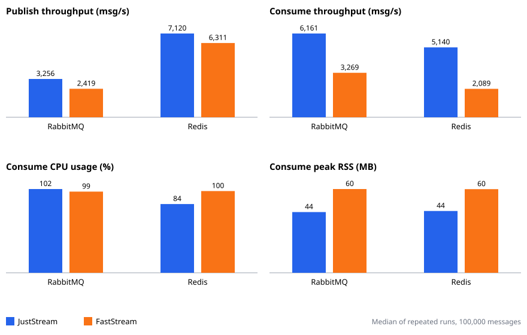

# FastStream performance comparison benchmark

[← Guide index](./README.en.md)

This benchmark compares JustStream and [FastStream](https://faststream.ag2.ai/) on publish and consume throughput and resource usage with RabbitMQ and Redis under identical conditions. It covers the method, environment, results with interpretation, and how to reproduce them. The numbers were measured in the environment below and may differ elsewhere.

## Method

Each broker and framework combination runs two phases in separate processes.

1. **Publish**: publishes N messages one at a time. The elapsed time gives the publish throughput (msg/s).
2. **Consume**: the consumer handles the N messages published beforehand. The elapsed time, from starting the subscription right after the broker connection to the end of the Nth handler, gives the consume throughput (msg/s).

Both phases also record the CPU usage and peak memory (RSS) of that process. CPU usage is the user plus system CPU time during the measured interval divided by the elapsed time, so 100% means one core was fully used. Peak memory is the maximum RSS (Resident Set Size, the amount of physical memory the process actually holds) since the process started; lower means less memory used. Each combination runs three times and the median is reported. If not every message is handled, the run fails and reports no result.

### Common conditions

| Item | Value |
| --- | --- |
| Messages | 100,000 |
| Message body | JSON object with `index` (integer) and `data` (256 `x` characters) |
| Handler | no-op that does nothing |
| Workers and prefetch | 10 each |
| Queue/stream | durable queue with persistent messages on RabbitMQ; Stream with a consumer group on Redis |
| Publishing | one message at a time, sequentially; waits for the publisher confirm on RabbitMQ |
| Acknowledgement | per-message ACK after the handler succeeds |
| Brokers | Docker containers (`rabbitmq:4.4`, `redis:7.4`) |

Framework-specific settings:

| Item | JustStream | FastStream |
| --- | --- | --- |
| Execution model | synchronous `Run` on `ThreadPool(10)` | `async def` handler on the event loop |
| RabbitMQ prefetch | `Subscription(qos=10)` | `Channel(prefetch_count=10)` |
| Redis prefetch | consumer `qos=10` | `StreamSub(max_records=10)` and `max_workers=10` |
| Logging | default (WARNING) | `logger=None` to disable per-message logs |

The JustStream `Worker` requeues a message when its pool is full, so prefetch equals the worker count. The FastStream RabbitMQ subscriber has no separate worker option, so prefetch sets the concurrency.

## Environment

| Item | Value |
| --- | --- |
| Date | 2026-11-19 |
| CPU | Intel Core i5-10600 @ 3.30GHz (12 logical cores) |
| Memory | 62 GiB |
| OS | Linux 6.12 (x86_64, glibc 2.41) |
| Python | 3.15.2 |
| JustStream | 0.1.32 (pika 1.5.0, redis 8.1.0) |
| FastStream | 0.7.8 (aio-pika 10.2.3, redis 8.1.0) |
| RabbitMQ, Redis | `rabbitmq:4.4`, `redis:7.4` (Docker on the same host, loopback) |

The brokers, the benchmark processes, and other workloads ran on the same host.

## Results

Medians of three runs.



| Broker | Framework | Publish (msg/s) | Consume (msg/s) | Publish CPU (%) | Consume CPU (%) | Publish peak RSS (MB) | Consume peak RSS (MB) |
| --- | --- | ---: | ---: | ---: | ---: | ---: | ---: |
| RabbitMQ | JustStream | 3,256 | 6,161 | 50 | 102 | 44 | 44 |
| RabbitMQ | FastStream | 2,419 | 3,269 | 66 | 99 | 60 | 60 |
| Redis | JustStream | 7,120 | 5,140 | 79 | 84 | 44 | 44 |
| Redis | FastStream | 6,311 | 2,089 | 94 | 100 | 58 | 60 |

Across the three runs of a combination, consume throughput ranged from 5,608 to 6,168 for RabbitMQ with JustStream and stayed within ±4% of the median for the other combinations.

### Interpretation

- Under these conditions JustStream consumed about 1.9 times faster than FastStream on RabbitMQ and about 2.5 times faster on Redis. Publish throughput was about 1.3 times higher on RabbitMQ and about 1.1 times higher on Redis.
- The FastStream consumer used about 100% CPU: its single event loop saturated one core. Because the handler is a no-op, per-message framework overhead such as parsing, decoding, and dependency handling determines the throughput.
- JustStream used 84% CPU when consuming from Redis, so it did not saturate a core. Broker round trips appear to be the limit in this setup.
- Peak memory is small for both: about 44 MB for JustStream and 58 to 60 MB for FastStream, with less than 1 MB of growth while consuming.

### Caveats

- A no-op handler shows only per-message framework overhead. With I/O-bound handlers that wait on a network or database, the concurrency of `async` handlers can be an advantage, and with CPU-heavy handlers the handler time dwarfs the overhead and the gap shrinks. Measure again with your real workload.
- Publishing makes one round trip per message. Batch publishing or pipelining changes the throughput of both frameworks.
- Both frameworks use untuned defaults. Changing the worker count, prefetch, serialization, or validation settings can change the results.
- Only a single consumer in one process was measured, not multi-process or multi-instance scaling.

## Reproducing the results

Run from the repository root. Docker is required, and the `resource` module limits this to Linux or macOS. FastStream is installed only for the benchmark and is not part of the `setup.py` extras.

```shell
python -m venv .venv
. .venv/bin/activate
pip install -e '.[RabbitMQ,Redis]'
pip install -r scripts/comps/requirements.txt
python scripts/comps/Benchmark.py
```

`scripts/comps/Benchmark.py` starts the broker containers (`juststream-bench-rabbitmq`, `juststream-bench-redis`) on `127.0.0.1` ports 35672 and 36379 and removes them when the measurement ends. Missing images are pulled on the first run. A full run with the default conditions took about 11 minutes.

| Option | Default | Description |
| --- | --- | --- |
| `--broker` | `all` | `rabbitmq`, `redis`, or `all` |
| `--count` | `100000` | Messages published and then consumed per run |
| `--size` | `256` | Padding bytes in each message body |
| `--concurrency` | `10` | Worker count and prefetch |
| `--repeat` | `3` | Runs per combination; the table shows medians |
| `--output` | none | JSON file with the environment and every run |
| `--chart` | none | SVG file for the comparison bar chart (the chart in this document was generated with `--chart docs/Benchmarks.svg`) |

For a quick sanity check, run `python scripts/comps/Benchmark.py --count 2000 --repeat 1`.
