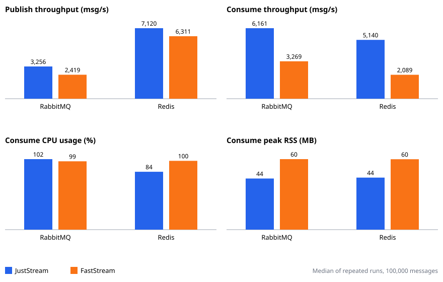

# FastStream 성능 비교 벤치마크

[← 매뉴얼 목차](./README.md)

JustStream과 [FastStream](https://faststream.ag2.ai/)의 발행·소비 처리량과 자원 사용량을 RabbitMQ와 Redis에서 같은 조건으로 비교한 벤치마크입니다. 이 문서는 측정 방법, 환경, 결과와 해석, 재현 방법을 다룹니다. 수치는 아래 환경에서 실제로 측정한 값이며 다른 환경에서는 달라질 수 있습니다.

## 측정 방법

각 브로커와 프레임워크 조합마다 다음 두 단계를 별도 프로세스에서 실행합니다.

1. **발행**: 메시지 N건을 하나씩 발행합니다. 소요 시간으로 발행 처리량(msg/s)을 계산합니다.
2. **소비**: 미리 발행해 둔 N건을 소비자가 모두 처리할 때까지의 시간으로 소비 처리량(msg/s)을 계산합니다. 시간은 브로커 연결 직후 구독을 시작하는 시점부터 N번째 핸들러가 끝나는 시점까지입니다.

두 단계 모두 해당 프로세스의 CPU 사용률과 최대 메모리(RSS)를 함께 측정합니다. CPU 사용률은 측정 구간의 사용자·시스템 CPU 시간을 경과 시간으로 나눈 값이며, 100%는 코어 하나를 계속 사용했다는 뜻입니다. 최대 메모리는 프로세스 시작 이후의 최대 RSS(Resident Set Size, 프로세스가 실제로 물리 메모리에 올려 둔 양)이며 작을수록 메모리를 적게 쓴다는 뜻입니다. 각 조합은 3회 실행하고 중앙값을 보고합니다. 모든 메시지를 처리하지 못하면 결과를 내지 않고 실패합니다.

### 공통 조건

| 항목 | 값 |
| --- | --- |
| 메시지 수 | 100,000건 |
| 메시지 본문 | JSON 객체 `index`(정수)와 `data`(`x` 256자) |
| 핸들러 | 아무 작업도 하지 않는 no-op |
| 워커 수 · prefetch | 모두 10 |
| 큐·스트림 | RabbitMQ는 내구성 큐와 영구 메시지, Redis는 Stream과 consumer group |
| 발행 방식 | 메시지마다 순차 발행하며 RabbitMQ는 발행 확인(publisher confirm)을 기다림 |
| 확인 방식 | 핸들러가 성공한 뒤 메시지마다 ACK |
| 브로커 | Docker 컨테이너(`rabbitmq:4.4`, `redis:7.4`) |

프레임워크별 설정은 다음과 같습니다.

| 항목 | JustStream | FastStream |
| --- | --- | --- |
| 실행 모델 | `ThreadPool(10)`의 동기 `Run` | 이벤트 루프의 `async def` 핸들러 |
| RabbitMQ prefetch | `Subscription(qos=10)` | `Channel(prefetch_count=10)` |
| Redis prefetch | consumer `qos=10` | `StreamSub(max_records=10)`와 `max_workers=10` |
| 로깅 | 기본 설정(WARNING) | 메시지별 로그를 끄기 위해 `logger=None` |

JustStream의 `Worker`는 풀이 가득 차면 메시지를 재큐잉하므로 prefetch를 워커 수와 같게 둡니다. FastStream의 RabbitMQ 구독자에는 별도의 워커 수 옵션이 없어 prefetch가 동시 처리 수를 정합니다.

## 측정 환경

| 항목 | 값 |
| --- | --- |
| 측정일 | 2026-11-19 |
| CPU | Intel Core i5-10600 @ 3.30GHz (12 논리 코어) |
| 메모리 | 62 GiB |
| 운영체제 | Linux 6.12 (x86_64, glibc 2.41) |
| Python | 3.15.2 |
| JustStream | 0.1.32 (pika 1.5.0, redis 8.1.0) |
| FastStream | 0.7.8 (aio-pika 10.2.3, redis 8.1.0) |
| RabbitMQ · Redis | `rabbitmq:4.4`, `redis:7.4` (같은 호스트의 Docker, 루프백 연결) |

브로커, 벤치마크 프로세스와 다른 작업이 같은 호스트에서 실행되었습니다.

## 결과

3회 실행의 중앙값입니다.



| 브로커 | 프레임워크 | 발행 (msg/s) | 소비 (msg/s) | 발행 CPU (%) | 소비 CPU (%) | 발행 최대 RSS (MB) | 소비 최대 RSS (MB) |
| --- | --- | ---: | ---: | ---: | ---: | ---: | ---: |
| RabbitMQ | JustStream | 3,256 | 6,161 | 50 | 102 | 44 | 44 |
| RabbitMQ | FastStream | 2,419 | 3,269 | 66 | 99 | 60 | 60 |
| Redis | JustStream | 7,120 | 5,140 | 79 | 84 | 44 | 44 |
| Redis | FastStream | 6,311 | 2,089 | 94 | 100 | 58 | 60 |

같은 조합의 3회 실행 사이에서 소비 처리량은 RabbitMQ JustStream이 5,608~6,168이었고, 나머지 조합은 중앙값의 ±4% 안이었습니다.

### 해석

- 이 조건에서 JustStream의 소비 처리량은 RabbitMQ에서 FastStream의 약 1.9배, Redis에서 약 2.5배였습니다. 발행 처리량은 RabbitMQ에서 약 1.3배, Redis에서 약 1.1배였습니다.
- FastStream의 소비 프로세스는 CPU 사용률이 약 100%로, 단일 이벤트 루프가 코어 하나를 모두 사용했습니다. 핸들러가 no-op이므로 메시지당 파싱·디코딩·의존성 처리 같은 프레임워크 오버헤드가 처리량을 정합니다.
- JustStream의 Redis 소비 CPU 사용률은 84%로 코어 하나를 다 쓰지 않았습니다. 이 조건에서는 브로커 왕복이 한계 요인으로 보입니다.
- 최대 메모리는 JustStream이 약 44MB, FastStream이 약 58~60MB로 모두 작고, 소비 중 증가량은 1MB 미만이었습니다.

### 해석할 때 주의할 점

- no-op 핸들러는 프레임워크 자체의 메시지당 오버헤드만 보여 줍니다. 네트워크나 데이터베이스를 기다리는 I/O 중심 핸들러에서는 `async` 핸들러의 동시성이 유리할 수 있고, CPU를 많이 쓰는 핸들러에서는 처리 시간이 오버헤드보다 커서 차이가 줄어듭니다. 실제 작업으로 다시 측정하세요.
- 발행은 메시지마다 한 건씩 왕복하는 방식입니다. 일괄 발행이나 파이프라인을 쓰면 두 프레임워크 모두 처리량이 달라집니다.
- 두 프레임워크 모두 튜닝하지 않은 기본 구성입니다. 워커 수와 prefetch를 바꾸거나 직렬화, 검증 설정을 조정하면 결과가 달라질 수 있습니다.
- 한 프로세스의 단일 소비자만 측정했으며 여러 프로세스나 여러 인스턴스로 확장한 결과는 다루지 않습니다.

## 재현 방법

저장소 루트에서 실행합니다. Docker가 필요하며 `resource` 모듈을 사용하므로 Linux 또는 macOS에서 동작합니다. FastStream은 벤치마크용으로만 설치하며 `setup.py`의 extras에는 포함되지 않습니다.

```shell
python -m venv .venv
. .venv/bin/activate
pip install -e '.[RabbitMQ,Redis]'
pip install -r scripts/comps/requirements.txt
python scripts/comps/Benchmark.py
```

`scripts/comps/Benchmark.py`는 브로커 컨테이너(`juststream-bench-rabbitmq`, `juststream-bench-redis`)를 `127.0.0.1`의 35672, 36379 포트로 실행하고 측정이 끝나면 제거합니다. 이미지가 없으면 처음 실행할 때 내려받습니다. 기본 조건으로 전체를 실행하는 데 약 11분이 걸렸습니다.

| 옵션 | 기본값 | 설명 |
| --- | --- | --- |
| `--broker` | `all` | `rabbitmq`, `redis` 또는 `all` |
| `--count` | `100000` | 실행마다 발행하고 소비할 메시지 수 |
| `--size` | `256` | 메시지 본문의 패딩 바이트 수 |
| `--concurrency` | `10` | 워커 수와 prefetch |
| `--repeat` | `3` | 조합별 실행 횟수. 표에는 중앙값을 출력 |
| `--output` | 없음 | 환경과 모든 실행 결과를 저장할 JSON 파일 |
| `--chart` | 없음 | 비교 막대 그래프를 저장할 SVG 파일 (이 문서의 그래프는 `--chart docs/Benchmarks.svg`로 생성) |

빠르게 동작만 확인하려면 `python scripts/comps/Benchmark.py --count 2000 --repeat 1`을 실행하세요.
