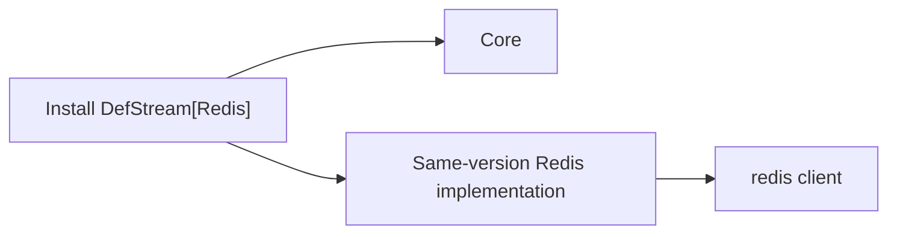

# Installation isolation, development and distribution

[한국어](./Packaging.md) · [Guide index](./README.en.md)

## Installed files

The `DefStream` core has no broker implementations. The `RabbitMQ` and `Redis` extras install the same-version `DefStream-RabbitMQ` and `DefStream-Redis` distributions and their external clients. Existing Python import paths remain unchanged.

In a new environment unselected implementation files and clients are absent. Omitting an extra later does not uninstall an existing implementation; explicitly remove its distribution when no longer needed.



## When you want to modify the source code

To fix or add features, use a development installation. An **editable installation** connects Python to your local source code so it can use that code directly.

Download the repository, activate a development virtual environment, and run the following command from the top-level folder containing `setup.py`. Here, `.` means the current folder and `-e` means an editable installation. You need pip 23 or later.

```shell
python -m pip install -e .
```

This connects only the common core source. To run and test the RabbitMQ or Redis implementation, use standard extras syntax. The following commands are separate examples: the first selects Redis only, and the second selects both implementations.

```shell
python -m pip install -e ".[Redis]"
python -m pip install -e ".[RabbitMQ,Redis]"
```

The selected extra installs the matching-version `DefStream-RabbitMQ` or `DefStream-Redis` wheel and its external client. The editable installation connects the repository's core source. Reinstalling with another extra does not automatically remove a previously installed implementation; explicitly uninstall it when it is no longer needed.

### Try your changes

1. Edit the code under `src/`.
2. Start your application or tests again in the same virtual environment to check the result. Code in an already running program is not automatically reloaded.
3. If you change the installation configuration, repeat the installation command with the desired extras.

The command connects the current core source on your computer; pip resolves implementation distributions and external libraries in its standard way.

### How the development connection works

Editable installs use setuptools' standard PEP 660 connection. Restart the language server if the IDE does not find the installed code immediately. Each virtual environment keeps its own installation state, and pip's normal dependency rules apply when extras are selected or removed.

## Build and validate

Installation checks explicitly select the locally built core and implementation wheels. Same-version files from PyPI cannot replace those validation artifacts; external dependencies still come from the package index.

Build and validate from the repository root:

```shell
python -m pip install "pip>=23" build "setuptools>=77" "setuptools-scm>=8,<10" wheel twine
python .github/scripts/build_distributions.py
python .github/scripts/check_distributions.py --editable
python -m twine check --strict dist/*
```

The build script fixes the version, then creates each target's wheel and sdist in `dist/`. Do not mix other versions' artifacts. `--outdir` selects another destination; `--wheel` builds only wheels.

Build dependencies are declared in `setup.py` using `setup_requires`. With no `pyproject.toml`, pip uses its default setuptools backend.

Each sdist includes `.distribution-target`, allowing `python -m build` to recreate the same distribution without an environment variable. Changing the sdist target is rejected.

`TargetEggInfo.find_sources()` in `setup.py` maintains the additional build sources included in sdists. No separate `MANIFEST.in` is used. This source list does not install helper scripts into regular wheels.

Sdists contain the shared source tree. Unselected implementation files are excluded from built wheels and installed files; the source archives themselves are not split into isolated source trees.

CI checks build and installation isolation on supported Python versions. Releases verify names, versions and build numbers, then publish implementations before the core. PyPI publishing permissions and the token must cover all three names. Local builds do not publish anything.
