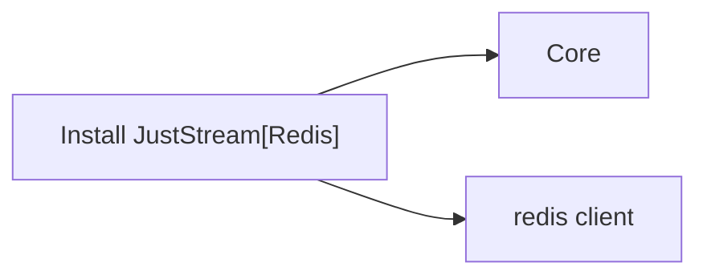

# Installation isolation, development and distribution

[한국어](./Packaging.md) · [Guide index](./README.en.md)

## Installed files

The single `JustStream` distribution always installs the core and all broker implementation sources. The `RabbitMQ` and `Redis` extras only add the external client dependencies (`pika` and `redis`). Existing Python import paths remain unchanged.

Without an extra, the implementation sources are installed but their clients are absent, so importing a broker module fails until the extra is installed. Omitting an extra later does not uninstall an already installed client.



## When you want to modify the source code

To fix or add features, use a development installation. An **editable installation** connects Python to your local source code so it can use that code directly.

Download the repository, activate a development virtual environment, and run the following command from the top-level folder containing `setup.py`. Here, `.` means the current folder and `-e` means an editable installation. You need pip 23 or later.

```shell
python -m pip install -e .
```

This connects the repository source, including all broker implementations. To run and test a broker, also install its client with standard extras syntax. The following commands are separate examples: the first selects Redis only, and the second selects both.

```shell
python -m pip install -e ".[Redis]"
python -m pip install -e ".[RabbitMQ,Redis]"
```

The selected extra installs only the matching external client (`pika` or `redis`). Reinstalling with another extra does not automatically remove a previously installed client.

### Try your changes

1. Edit the code under `src/`.
2. Start your application or tests again in the same virtual environment to check the result. Code in an already running program is not automatically reloaded.
3. If you change the installation configuration, repeat the installation command with the desired extras.

The command connects the current source on your computer; pip resolves external libraries in its standard way.

### How the development connection works

Editable installs use setuptools' standard PEP 660 connection. Restart the language server if the IDE does not find the installed code immediately. Each virtual environment keeps its own installation state, and pip's normal dependency rules apply when extras are selected or removed.

## Build and validate

Installation checks explicitly select the locally built wheel. The same-version file from PyPI cannot replace that validation artifact; external dependencies still come from the package index.

Build and validate from the repository root:

```shell
python -m pip install "pip>=23" build "setuptools>=77" "setuptools-scm>=8,<10" wheel twine
python -m build
python .github/scripts/check_distributions.py --editable
python -m twine check --strict dist/*
```

The build creates one wheel and one sdist for `JustStream` in `dist/`. Do not mix other versions' artifacts. `--wheel` builds only the wheel.

Build dependencies are declared in `setup.py` using `setup_requires`. With no `pyproject.toml`, pip uses its default setuptools backend.

CI checks the build and installation on supported Python versions. Releases verify the name, version and build number, then publish the single `JustStream` distribution. Local builds do not publish anything.

### Public version decision

A change that reaches `master` and passes verification is published to PyPI, whether it is a direct push or a merged PR. The public version (`MAJOR.MINOR.PATCH`) comes from the issues linked to the merged PR (those GitHub recognizes, such as `Closes #N`), not from changed file paths. The issue type and labels are checked together, case-insensitively.

| Issue type or label | Public version |
| --- | --- |
| `feature` | Increase `MINOR` and reset `PATCH` to 0 (`0.1.29` → `0.2.0`) |
| `bug`, `fix` | Increase `PATCH` |
| Any other value, or none | Keep |

- If the type or any label is `feature`, `MINOR` increases; otherwise, if any is `bug` or `fix`, `PATCH` increases. For example, a `Task` issue with a `feature` label increases `MINOR`.
- With several linked issues, each is evaluated and the highest increase (`MINOR` > `PATCH` > keep) is used.
- A PR without a linked issue and a direct push to `master` keep the public version.
- The base version is the highest `MAJOR.MINOR.PATCH` tag contained in the commit before the push. After `MINOR` increases, later `PATCH` releases continue in the new `MAJOR.MINOR` series (`0.2.0` → `0.2.1`). `MAJOR` changes are not handled.
- Keeping the public version publishes only a wheel with a new build number and keeps the existing release notes.

### Tags for release notes

When the public version increases (a merged PR linked to an issue whose type or label is `feature`, `bug` or `fix`), the message of an annotated tag named `changes/<commit SHA>` becomes the GitHub Release body. The `changes/` prefix is required because GitHub rejects tag names that consist only of a full SHA. The release fails if the tag is missing, is a lightweight tag, or has an empty message. Releases that keep the public version, including direct pushes, reuse the existing release notes and need no tag.

- A merged PR reads the `changes/<SHA>` tag of the PR's last commit (`head.sha`), not the merge result, from the PR's source repository (original or fork).

Push the tag to the source repository before merging the PR.

```shell
git tag -a "changes/$(git rev-parse HEAD)" -F CHANGELOG.md
git push origin "changes/$(git rev-parse HEAD)"
```
