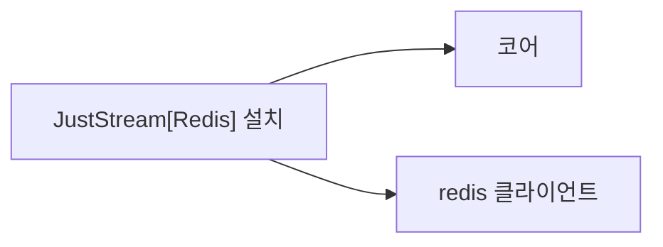

# 설치 격리와 개발·배포

[English](./Packaging.en.md) · [매뉴얼 목차](./README.md)

## 무엇이 설치되는가

단일 `JustStream` 배포물은 코어와 모든 브로커 구현체 소스를 항상 설치합니다. `RabbitMQ`와 `Redis` extras는 외부 클라이언트 의존성(`pika`, `redis`)만 추가합니다. 기존 Python import 경로는 유지합니다.

extra 없이 설치하면 구현체 소스는 있지만 클라이언트가 없어, 해당 브로커 모듈을 import하려면 extra를 설치해야 합니다. 나중에 extra를 생략해도 이미 설치한 클라이언트는 제거되지 않습니다.



## 소스 코드를 직접 수정하고 싶을 때

기능을 고치거나 추가하고 싶다면 개발용 설치를 사용하세요. 내려받은 소스 코드를 Python이 직접 사용하도록 연결하는 방식을 **editable 설치**라고 합니다.

저장소를 내려받고 개발용 가상환경을 활성화한 뒤, `setup.py`가 있는 저장소 최상위 폴더에서 실행하세요. 이 명령의 `.`은 현재 폴더, `-e`는 editable 설치를 뜻합니다. pip 23 이상이 필요합니다.

```shell
python -m pip install -e .
```

위 명령은 모든 브로커 구현체를 포함한 저장소 소스를 연결합니다. 브로커를 실행하고 테스트하려면 표준 extras 문법으로 클라이언트도 설치하세요. 다음 두 명령은 각각 Redis만 선택하는 예시와 두 브로커를 모두 선택하는 예시입니다.

```shell
python -m pip install -e ".[Redis]"
python -m pip install -e ".[RabbitMQ,Redis]"
```

선택한 extra는 해당 외부 클라이언트(`pika` 또는 `redis`)만 설치합니다. 다른 extra로 다시 설치해도 pip가 기존 클라이언트를 자동으로 제거하지는 않습니다.

### 수정한 코드 확인하기

1. `src/` 아래의 코드를 수정합니다.
2. 같은 가상환경에서 애플리케이션이나 테스트를 새로 실행해 수정 결과를 확인합니다. 이미 실행 중인 프로그램의 코드는 자동으로 다시 로드되지 않습니다.
3. 설치 구성을 바꿨다면 원하는 extras를 포함해 설치 명령을 다시 실행합니다.

이 명령은 컴퓨터에 있는 현재 소스를 연결하며 외부 라이브러리는 pip가 일반적으로 패키지를 설치하는 방식으로 확인합니다.

### 개발 환경의 연결 방식과 주의사항

editable 설치는 setuptools의 기본 PEP 660 연결을 사용합니다. IDE가 설치 결과를 바로 찾지 못하면 Language Server를 재시작하세요. 각 가상환경의 설치 상태는 독립적으로 유지되며, 브로커 extra를 고르거나 제거할 때는 pip의 일반 의존성 규칙이 적용됩니다.

## 빌드와 검증

설치 검사는 로컬에서 빌드한 wheel을 직접 지정합니다. PyPI의 같은 버전 파일로 검증 대상이 바뀌지 않으며, 외부 의존성은 기존처럼 패키지 인덱스에서 받습니다.

저장소 루트에서 전체 배포물을 빌드·검사합니다.

```shell
python -m pip install "pip>=23" build "setuptools>=77" "setuptools-scm>=8,<10" wheel twine
python -m build
python .github/scripts/check_distributions.py --editable
python -m twine check --strict dist/*
```

빌드는 `JustStream`의 wheel과 sdist를 `dist/`에 하나씩 만듭니다. 다른 버전 산출물이 섞이지 않은 디렉터리를 사용하세요. `--wheel`로 wheel 전용 빌드를 선택할 수 있습니다.

빌드 의존성은 `setup.py`의 `setup_requires`에 선언하며, `pyproject.toml` 없이 pip의 기본 setuptools 백엔드를 사용합니다.

CI는 지원 Python별 빌드·설치를 검사하며, 릴리즈에서 이름·버전·빌드 번호를 확인하고 단일 `JustStream` 배포물을 게시합니다. 로컬 빌드만으로 게시하지는 않습니다.

### 공개 버전 결정

`master`에 변경이 반영되고 검증을 통과하면 직접 푸시든 PR 병합이든 PyPI에 배포합니다. 공개 버전(`MAJOR.MINOR.PATCH`)은 병합된 PR에 연결된 이슈(`Closes #N` 등 GitHub가 연결로 인식하는 이슈)로 정하며, 변경한 파일 경로는 사용하지 않습니다. 이슈 유형이 있으면 유형을, 유형이 없을 때만 레이블을 사용합니다.

| 이슈 유형 | 유형이 없을 때의 레이블 | 공개 버전 |
| --- | --- | --- |
| `Feature` | `feature` | `MINOR` 증가, `PATCH`를 0으로 초기화 (`0.1.29` → `0.2.0`) |
| `Bug` | `bug`, `fix` | `PATCH` 증가 |
| `Task` | `task`, 그 밖의 레이블, 레이블 없음 | 유지 |

- 연결 이슈가 둘 이상이면 이슈마다 판정한 뒤 가장 높은 증가(`MINOR` > `PATCH` > 유지)를 사용합니다.
- 연결 이슈가 없는 PR과 `master` 직접 푸시는 공개 버전을 유지합니다.
- 기준 버전은 푸시 이전 커밋에 포함된 `MAJOR.MINOR.PATCH` 태그 중 가장 큰 값이며, `MINOR`가 올라가면 이후 `PATCH`는 새 `MAJOR.MINOR` 계열에서 증가합니다(`0.2.0` → `0.2.1`). `MAJOR` 변경은 다루지 않습니다.
- 공개 버전을 유지하면 같은 버전에 새 빌드 번호의 wheel만 배포하고 기존 릴리스 노트를 유지합니다.

### 릴리스 노트용 태그

공개 버전이 오르면(`Feature` 또는 `Bug` 이슈가 연결된 PR 병합) GitHub Release 본문으로 `changes/<커밋 SHA>` 이름의 annotated tag 메시지를 사용합니다. GitHub는 전체 SHA만으로 된 태그 이름을 허용하지 않으므로 `changes/` 접두사가 필요하며, 태그가 없거나 lightweight tag이거나 메시지가 비어 있으면 릴리스가 실패합니다. 공개 버전을 유지하는 배포(직접 푸시 포함)는 기존 릴리스 노트를 재사용하므로 태그가 필요하지 않습니다.

- PR을 병합하면 병합 결과가 아니라 PR의 마지막 커밋(`head.sha`)로 만든 `changes/<SHA>` 태그를 PR 출발 저장소(원본 또는 fork)에서 읽습니다.

PR을 병합하기 전에 태그를 출발 저장소에 올려 두어야 합니다.

```shell
git tag -a "changes/$(git rev-parse HEAD)" -F CHANGELOG.md
git push origin "changes/$(git rev-parse HEAD)"
```
