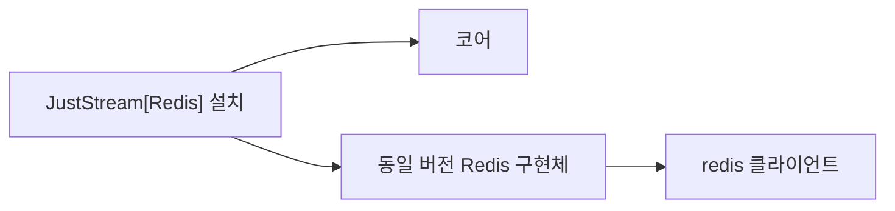

# 설치 격리와 개발·배포

[English](./Packaging.en.md) · [매뉴얼 목차](./README.md)

## 무엇이 설치되는가

`JustStream` 코어에는 브로커 구현체가 없습니다. `RabbitMQ`와 `Redis` extras는 각각 동일 버전 `JustStream-RabbitMQ`, `JustStream-Redis` 배포물과 외부 클라이언트를 설치합니다. 기존 Python import 경로는 유지합니다.

새 환경에서는 선택하지 않은 구현체 파일과 클라이언트가 설치되지 않습니다. 나중에 extra를 생략해도 이미 설치한 구현체는 제거되지 않으므로 필요 없다면 해당 구현체 배포물을 명시적으로 제거하세요.



## 소스 코드를 직접 수정하고 싶을 때

기능을 고치거나 추가하고 싶다면 개발용 설치를 사용하세요. 내려받은 소스 코드를 Python이 직접 사용하도록 연결하는 방식을 **editable 설치**라고 합니다.

저장소를 내려받고 개발용 가상환경을 활성화한 뒤, `setup.py`가 있는 저장소 최상위 폴더에서 실행하세요. 이 명령의 `.`은 현재 폴더, `-e`는 editable 설치를 뜻합니다. pip 23 이상이 필요합니다.

```shell
python -m pip install -e .
```

공통 코어 소스만 연결하려면 위 명령을 사용합니다. RabbitMQ나 Redis 구현체도 실행하고 테스트하려면 표준 extras 문법을 사용하세요. 다음 두 명령은 각각 Redis만 선택하는 예시와 두 구현체를 모두 선택하는 예시입니다.

```shell
python -m pip install -e ".[Redis]"
python -m pip install -e ".[RabbitMQ,Redis]"
```

선택한 extra는 같은 버전의 `JustStream-RabbitMQ` 또는 `JustStream-Redis` wheel과 외부 클라이언트를 설치합니다. editable로 연결되는 것은 저장소의 코어 소스입니다. 다른 extra로 다시 설치해도 pip가 기존 구현체 배포물을 자동으로 제거하지는 않습니다. 필요 없는 구현체는 해당 배포물을 명시적으로 제거하세요.

### 수정한 코드 확인하기

1. `src/` 아래의 코드를 수정합니다.
2. 같은 가상환경에서 애플리케이션이나 테스트를 새로 실행해 수정 결과를 확인합니다. 이미 실행 중인 프로그램의 코드는 자동으로 다시 로드되지 않습니다.
3. 설치 구성을 바꿨다면 원하는 extras를 포함해 설치 명령을 다시 실행합니다.

이 명령은 컴퓨터에 있는 현재 코어 소스를 연결하며 구현체 배포물과 외부 라이브러리는 pip가 일반적으로 패키지를 설치하는 방식으로 확인합니다.

### 개발 환경의 연결 방식과 주의사항

editable 설치는 setuptools의 기본 PEP 660 연결을 사용합니다. IDE가 설치 결과를 바로 찾지 못하면 Language Server를 재시작하세요. 각 가상환경의 설치 상태는 독립적으로 유지되며, 구현체 extra를 고르거나 제거할 때는 pip의 일반 의존성 규칙이 적용됩니다.

## 빌드와 검증

설치 검사는 로컬에서 빌드한 코어와 선택 구현체 wheel을 직접 지정합니다. PyPI의 같은 버전 파일로 검증 대상이 바뀌지 않으며, 외부 의존성은 기존처럼 패키지 인덱스에서 받습니다.

저장소 루트에서 전체 배포물을 빌드·검사합니다.

```shell
python -m pip install "pip>=23" build "setuptools>=77" "setuptools-scm>=8,<10" wheel twine
python .github/scripts/build_distributions.py
python .github/scripts/check_distributions.py --editable
python -m twine check --strict dist/*
```

빌드 스크립트는 버전을 고정하고 대상별 wheel과 sdist를 `dist/`에 만듭니다. 다른 버전 산출물이 섞이지 않은 디렉터리를 사용하세요. `--outdir`로 다른 위치를, `--wheel`로 wheel 전용 빌드를 선택할 수 있습니다.

빌드 의존성은 `setup.py`의 `setup_requires`에 선언하며, `pyproject.toml` 없이 pip의 기본 setuptools 백엔드를 사용합니다.

각 sdist에는 `.distribution-target`이 포함되어 별도 환경변수 없이 `python -m build`로 같은 배포물을 재생성합니다. sdist의 대상 변경은 거부합니다.

빌드에 필요한 보조 소스의 sdist 포함 목록은 `setup.py`의 `TargetEggInfo.find_sources()`에서 관리합니다. 별도의 `MANIFEST.in`은 사용하지 않으며, 이 목록은 일반 wheel에 보조 스크립트를 설치하는 설정이 아닙니다.

sdist는 공통 소스 트리를 포함합니다. 선택하지 않은 구현체의 파일을 제외하는 경계는 빌드된 wheel과 최종 설치 파일이며, sdist 원본 소스의 배포까지 분리하는 구조는 아닙니다.

CI는 지원 Python별 빌드·설치 격리를 검사하며, 릴리즈에서 이름·버전·빌드 번호를 확인하고 구현체를 먼저, 코어를 나중에 게시합니다. PyPI 게시 권한과 토큰은 세 배포 이름을 지원해야 합니다. 로컬 빌드만으로 게시하지는 않습니다.
